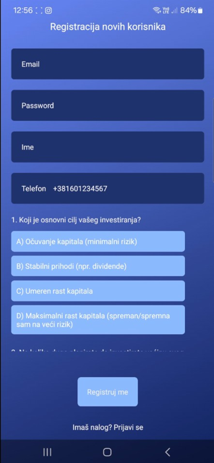
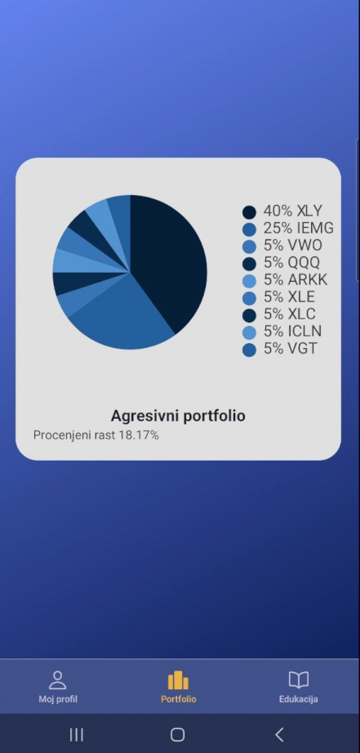
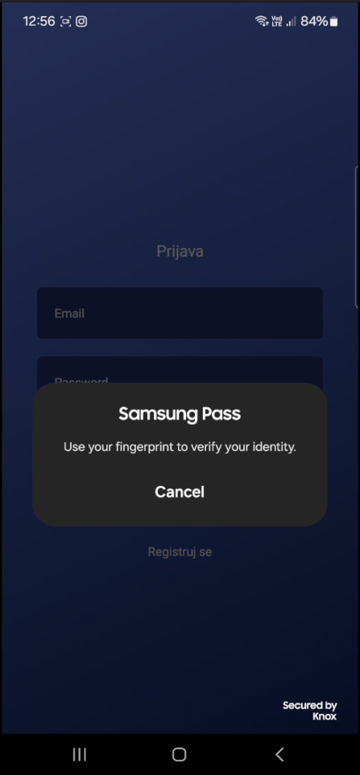
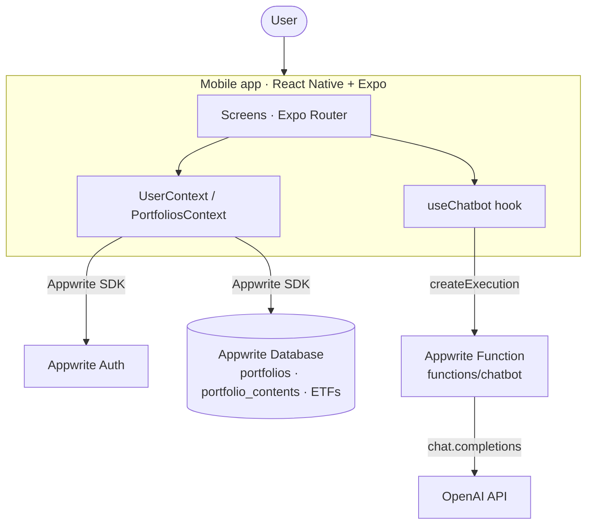
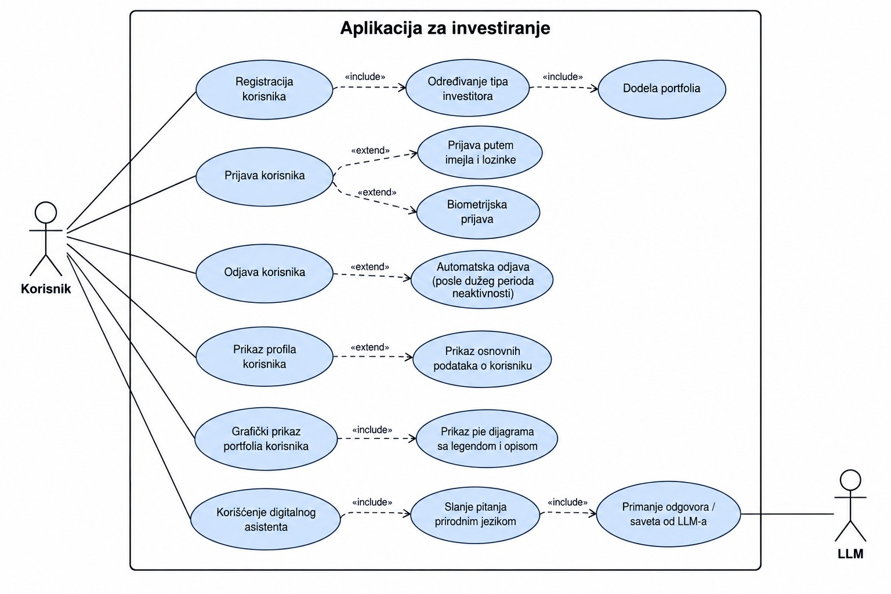

# Investment Beacon

A React Native (Expo) Android app that helps **beginner investors** get started: a short risk questionnaire assigns an investor profile, the app recommends a matching ETF portfolio and visualises it, and an AI assistant answers investing questions in plain language.

Built as my BSc thesis, *"Development of an Android Mobile Application for Beginner Investing"*, Singidunum University, Faculty of Technical Sciences (2026), under the mentorship of prof. dr Miodrag Živković.

> **Note:** The app is an educational tool, not a trading platform or financial advice. The assistant only explains concepts; it does not make investment decisions.

<p align="center">
  
  
  
  
</p>

## Features

- **Sign up with an investment questionnaire.** New users answer 11 questions based on an Investment Policy Statement (IPS). Each answer carries points, and the total sets the investor profile:
  - **Aggressive:** 25 points or more
  - **Balanced:** 15–24 points
  - **Conservative:** fewer than 15 points
- **Login, including biometrics.** Email/password login through Appwrite sessions. Android Autofill can fill the login fields, so password managers such as Samsung Pass can offer fingerprint login. The app has no biometric code of its own.
- **Persistent session and protected routes.** The user object is held in a global `UserContext`, so it survives app restarts. A `UserOnly` guard redirects guests away from the dashboard.
- **Portfolio recommendation and visualisation.** The investor profile selects a portfolio from the Appwrite database. Its ETFs and weights are rendered as a sorted pie chart with a legend using `react-native-chart-kit`.
- **AI assistant.** Users ask questions in natural language. Requests go through an Appwrite Function that calls the OpenAI API, so the API key never ships in the app.

## Tech stack

| Layer | Technology |
|---|---|
| Mobile app | React Native 0.81, Expo 54, Expo Router, React 19 |
| Backend (BaaS) | Appwrite: Auth, Databases, Functions |
| AI | OpenAI API (`gpt-4o-mini`) through an Appwrite Function (Node.js) |
| Charts | react-native-chart-kit, react-native-svg |

**Why these choices:**
- **React Native over Kotlin/Java or Flutter:** one codebase that can later target iOS, plus the JavaScript ecosystem.
- **Appwrite over Firebase or Supabase:** simple React Native integration, and a document/collection model that fits the data.

## Architecture



The client handles UI, navigation and app logic. Appwrite handles accounts, sessions, data and per-document permissions. The assistant gets its own server-side layer (Appwrite Functions), which keeps the external GPT call out of the client.

### Data model

A portfolio contains several ETFs, and one ETF can appear in several portfolios with different weights. This many-to-many relationship is resolved by the **`portfolio_contents`** junction collection, which stores each ETF's percentage within a portfolio. `PortfoliosContext` first finds the user's portfolio (`fetchPortfolioByUser`), then resolves its ETFs and weights (`fetchEtfsFromPortfolio`).

### Use cases

<details>
<summary>Use-case diagram (in Serbian, from the thesis)</summary>



</details>

## Project structure

```
app/
  (auth)/          login.jsx, register.jsx       – authentication screens
  (dashboard)/     profile.jsx, portfolio.jsx,   – main tabs after login
                   news.jsx                      – AI assistant screen
contexts/          UserContext.jsx               – register / login / logout, user state
                   PortfoliosContext.jsx         – portfolio + ETF fetching
hooks/             useUser.js, usePortfolio.js, useChatbot.js
components/        Themed* UI components, auth/UserOnly.jsx, auth/GuestOnly.jsx
lib/appwrite.js    Appwrite client (Account, Databases, Functions)
functions/chatbot  Appwrite Function that proxies prompts to OpenAI
```

## Getting started

**Prerequisites:**
- [Git](https://git-scm.com/downloads)
- [Node.js](https://nodejs.org/en/download) 20.19.4+
- An [Appwrite](https://appwrite.io/docs) project (Cloud or self-hosted)
- An [OpenAI API key](https://platform.openai.com/api-keys), for the assistant
- An Android device with [Expo Go](https://expo.dev/go), or an emulator
- For `npm run android` only: [Android Studio with the Android SDK, and JDK 17](https://reactnative.dev/docs/set-up-your-environment)

**1. Install and run the app:**

```bash
git clone https://github.com/veljko-milisavljevic/Investment-Beacon.git
cd Investment-Beacon
npm install
npx expo start            # scan the QR code with Expo Go
# or build a native dev client:
npm run android
```

The app does not read `.env` yet. Replace the Appwrite project ID in `lib/appwrite.js` with your own. The client uses the SDK's default Appwrite Cloud endpoint, so for another region or a self-hosted server also add `.setEndpoint(...)` there.

**2. Set up the Appwrite backend:**
1. Create a database with three collections: `portfolios`, `etfs` and `portfolio_contents`. Add one portfolio per investor profile (aggressive, balanced, conservative). In `contexts/PortfoliosContext.jsx`, set your database ID and the document IDs of the three portfolios.
2. Register an Android platform with the package name `dev.investment_beacon.investment_app`.
3. Deploy the assistant function from `functions/chatbot`:
   - Runtime: Node 18+
   - Entrypoint: `src/main.js`
   - Build command: `npm install`
   - Environment variables: `OPENAI_API_KEY` (required) and `OPENAI_MAX_TOKENS` (optional, default 512)
4. Put the deployed function's ID in `hooks/useChatbot.js`.

## Roadmap

- Store the full questionnaire answers server-side, not just the score, to enable richer profiling.
- Expand the user profile screen.
- Give the assistant context about the user's own profile and portfolio.
- iOS build. The codebase is already cross-platform.

## Author

**Veljko Milisavljević** · [LinkedIn](https://www.linkedin.com/in/veljko-milisavljevi%C4%87-72419542b/) · [GitHub](https://github.com/veljko-milisavljevic)
